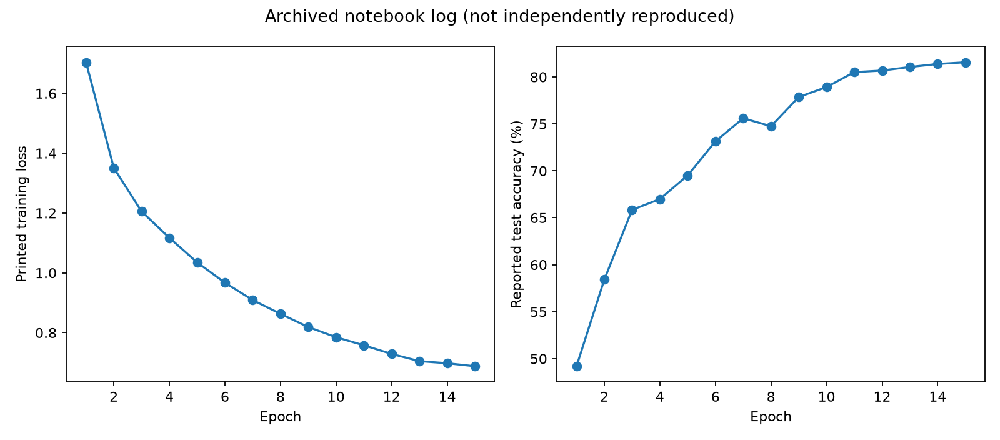
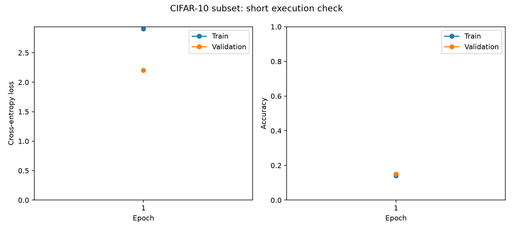
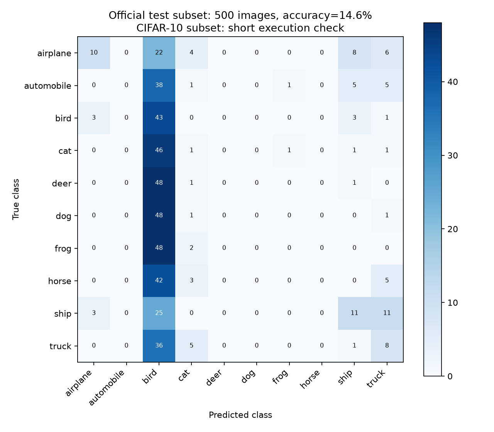

# Results: historical log and maintained verification

Checked on 2026-10-23. The two evidence categories below are intentionally distinct.

## 1. Historical notebook output

The unchanged `notebooks/original_experiment.ipynb` contains 15 saved epoch lines from a CUDA run. The final line reports train loss **0.688** and official-test accuracy **81.56%**. These values are transcribed from saved output, not freshly reproduced model evaluation. The original README names an NVIDIA T4; the saved runtime output itself only establishes that it reported `cuda`.

The notebook checks official-test accuracy every epoch and uses all 50,000 official training images without a separate validation split. Its test-monitoring protocol differs from the maintained trainer. The original checkpoint was not part of the repository and was not recovered from the checked local project locations, so its reported score cannot be independently verified from weights here. Unsupported claims that transfer learning would automatically achieve a particular score have been removed.

See [machine-readable archived epoch log](historical-log.json).

## 2. Maintained implementation: execution smoke run

The original 2,640,010-parameter AdvancedCNN architecture was retained with compatible layer names. The new pipeline was trained for **one epoch on a balanced 1,000-image subset** of official training data and validated on **200 disjoint training-pool images**. The configuration is `configs/smoke.json`; seed 42, CPU with two Torch threads, batch size 64, AdamW learning rate 0.001 and weight decay 1e-4.

| Measure | Observed value | Scope |
| --- | ---: | --- |
| Train cross-entropy | 2.906687 | One epoch, 1,000 augmented images |
| Best validation accuracy | 15.0% | 200 disjoint validation images |
| Separate test accuracy | 14.6% | Stratified 500-image official-test subset |
| Separate test cross-entropy | 2.216175 | Same 500-image subset |

This small run checks optimization, checkpoint selection/loading, normalization, evaluation, and plotting. Its low accuracy is not a claim of a converged classifier or a new 15-epoch benchmark. No tuning was performed to improve the smoke score. The training function did not use official-test images/labels for fitting or checkpoint selection. Torchvision checksums may read all dataset files for integrity verification.

The best checkpoint was reloaded with `weights_only=True`, exact architecture/class order/normalization checks, and evaluated using a separate command. Image inference also completed on a local CIFAR sample converted through the same RGB resize/normalization path. The original sample image and all weights remain local.

## Reproduction and integrity

The source archive's MD5 was verified as `c58f30108f718f92721af3b95e74349a`, matching the official CIFAR Python archive. Torchvision validated the extracted batches. See [data instructions](../data/README.md) and the official source citation there.

The maintained smoke run uses Python 3.12.14, torch 2.14.1+cpu, torchvision 0.29.1+cpu, NumPy 2.5.4, and Pillow 13.0.0. See [aggregate smoke metadata](verified-smoke.json) and `constraints-py312-cpu-tested.txt`. Exact training/validation indices and selected test subset indices are retained in local run files; test selection seed is 44. Results may differ across device/library versions.

Use the README's short smoke commands to verify execution. For a new full benchmark, use `configs/default.json` with 45,000 training and 5,000 validation images, then explicitly evaluate the selected checkpoint on all 10,000 test images. That full 15-epoch retraining was not performed during this restructuring.
