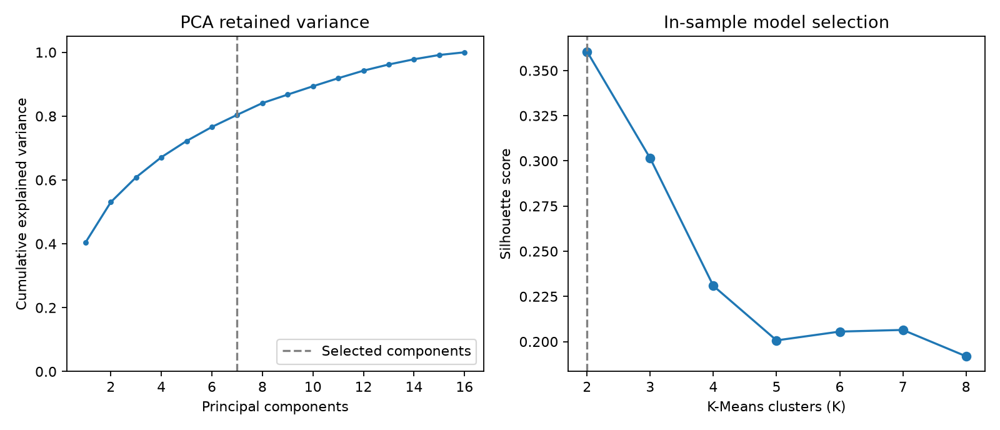

# Customer Segmentation for Marketing

Reproducible descriptive analysis with fitted imputation/clipping, scaling, PCA, K-Means selection, independent GMM soft clusters, saved-model inference, and aggregate reports. The original notebook is retained as historical exploration.

[Automated checks](https://github.com/ssargsyann/aca-projects/actions/workflows/customer-segmentation-checks.yml) · [Model card](MODEL_CARD.md) · [Real-data results](docs/results.md) · [Data source/schema](data/README.md)

## Verified results

The version-1 Kaggle input contains **2,240 rows and 29 fields**. This model retains every row, imputes 24 missing income values, and selects 16 numeric features. **Seven PCA components retain 80.41% variance**. Among K=2 through 8, **K=2 has the highest in-sample silhouette: 0.3605**. Three alternate optimization seeds give adjusted Rand index 1.0 on the same cohort; this assesses initialization sensitivity, not sampling stability or generalization.

The original README's four personas were illustrative. The verified run selects two descriptive segments. No supervised accuracy or campaign-response uplift is claimed.



## Structure

```text
configs/default.json         Explicit features and model settings
src/customer_segments/
  data.py                    Schema, fitted medians, quantile clipping
  train.py                   PCA, candidate K scores, K-Means, GMM
  profiles.py                Observed profiles and independent soft labels
  predict.py                 Saved-model row assignment
  report.py                  Aggregate charts
  demo.py                    Invented-data workflow
  download.py                Versioned KaggleHub retrieval
  cli.py                     Command-line interface
tests/                       Regression checks
notebooks/                   Two maintained workflows and original notebook
data/                        Local dataset instructions
artifacts/                   Ignored records, models, and outputs
docs/                        Verified aggregate results and validation
MODEL_CARD.md                Intended use, interpretation, and limits
```

## Install

Python 3.10 or newer. From the collection root:

```bash
cd projects/customer-segmentation-marketing
python -m venv .venv
```

Activate with `.venv\Scripts\Activate.ps1` in PowerShell or `source .venv/bin/activate` on macOS/Linux, then:

```bash
python -m pip install -e ".[reports]"
```

For notebooks use `python -m pip install -e ".[notebook]"`. To constrain the tested Python 3.12 runtime/report versions, use `python -m pip install -c constraints-py312-tested.txt -e ".[reports]"`. These constraints describe the tested Windows runtime, not a complete cross-platform Jupyter lock.

## Dataset-free demo

```bash
customer-segments demo --output artifacts/demo
customer-segments report --run artifacts/demo/run --output artifacts/demo/report
```

This generates invented data, fits the pipeline, reloads it, and writes assignments. Its configuration and notice mark it `SYNTHETIC_DEMO_ONLY`; those scores are not the real-data results above. Use a new or empty output folder to preserve existing runs.

## Source-data workflow

The original notebook names [Customer Personality Analysis](https://www.kaggle.com/datasets/imakash3011/customer-personality-analysis). See [data/README.md](data/README.md) for attribution, source CC0 designation, and schema.

```bash
python -m pip install -e ".[download]"
customer-segments download --output data/marketing_campaign.csv
customer-segments train --data data/marketing_campaign.csv --config configs/default.json --output artifacts/run
customer-segments report --run artifacts/run --output artifacts/report
```

You may instead place an authorized source copy at the same path. Retrieval requests version 1 and preserves existing destinations. Complete any authentication or consent required by Kaggle through its normal flow; never put tokens in Git.

## Assign new rows

```bash
customer-segments predict --model artifacts/run/segmentation.joblib --data data/new_customers.csv --output artifacts/new_assignments.csv
```

Supply the configured 16 numeric fields in the same source units. Fitted medians and clipping bounds are reused. Missing columns and invalid/infinite values are rejected; extra fields such as ID are ignored. Zero-based `row_number` preserves input order.

Outputs include `kmeans_segment`, `segment_description`, independent `gmm_component`, GMM probabilities, and a top-two probability-gap boundary flag. **GMM component numbers are not K-Means persona numbers.** Their probabilities describe a mixture, not purchase intent. Refit segment IDs may change; reuse the saved model for consistent assignments. Load only trusted joblib artifacts.

## Artifacts

- `segmentation.joblib`: fitted preprocessing, PCA, K-Means, GMM, settings, and descriptions.
- `metrics.json`: in-sample K scores, retained variance, seed checks, and GMM convergence.
- `run.json`: input checksum, configuration, learned medians, and package versions.
- `cluster_profiles.csv`: observed original-unit means and counts.
- `assignments.csv`: local per-row assignments and soft-membership diagnostics.

Reporting writes model-selection and profile figures. Training/demo runs refuse to overwrite nonempty output directories. Raw records, models, and row assignments stay local; aggregate results and charts are published.

## Modeling choices

IDs, response/campaign acceptance fields, constants, categories, and enrollment dates are excluded from the default feature list. Median imputation preserves every row. Fitted 1st/99th-percentile clipping reduces extreme-value influence before standardization and PCA. K-Means chooses the best silhouette among configured candidates. Scores use all rows in this run; larger datasets use the configured deterministic sample cap.

This is whole-cohort descriptive clustering, with no supervised target or claimed holdout accuracy. Three alternate K-Means seeds assess optimization sensitivity only. GMM independently fits the same PCA representation; boundary flags use an unrounded top-two posterior gap <= 0.10.

Profiles use original observed values before clipping/imputation, and income observation counts are supplied. Names describe relative spending/discount purchasing without asserting campaign effectiveness. Birth year is used directly; no changing current-year age is invented. See the [model card](MODEL_CARD.md) for limits.

## Notebooks and tests

```bash
python -m pip install -e ".[notebook]"
jupyter lab
python -m unittest discover -s tests -v
```

Open [quickstart.ipynb](notebooks/quickstart.ipynb) for invented data or [real-data-workflow.ipynb](notebooks/real-data-workflow.ipynb) for source data. Select the environment containing this package. Both call maintained code. The unchanged original notebook has a different baseline and optional UMAP sandbox; see [notebooks/README.md](notebooks/README.md).

GitHub Actions checks regressions, the synthetic CLI demo, and reporting. See [validation details](docs/validation.md).
