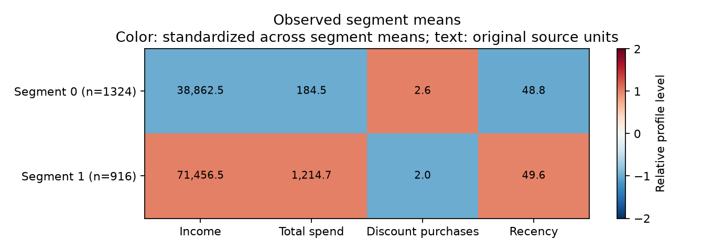

# Verified source-data run

Run date: 2026-10-23. Input: `marketing_campaign.csv` from the original notebook's named Kaggle dataset, local version-1 cache. [Source and license](../data/README.md). Raw records and per-row assignments remain local.

## Protocol

- 2,240 rows, 29 source columns, 16 explicit numeric features.
- All rows retained; 24 missing income entries median-imputed.
- Fitted 1st/99th-percentile clipping, standardization, and PCA.
- Seven principal components retain 0.804103 of scaled variance.
- K-Means candidates 2 through 8, seed 42, `n_init=10`.
- Full-cohort silhouette scores: no sampling was needed for this dataset.
- Same-cohort initialization checks with seeds 43, 44, 45.
- Separate GMM with two components, three initializations, covariance regularization 1e-6.

This is descriptive batch analysis. Model selection and evaluation use the fitted cohort, not a held-out test. Silhouette is not classification accuracy.

## Candidate scores

| K | Silhouette |
| --- | ---: |
| 2 | 0.360505 |
| 3 | 0.301404 |
| 4 | 0.230820 |
| 5 | 0.200669 |
| 6 | 0.205550 |
| 7 | 0.206461 |
| 8 | 0.191891 |

The configured criterion selected **K=2**. This is the best tested solution under the chosen features, preprocessing, and distance metric; it does not prove there are exactly two inherent customer types. A business requirement for 3–4 campaigns is a separate decision, and the data have not validated campaign effectiveness for any K.


## Observed profiles

| Segment | Customers | Share | Income mean | Income observed | Total spend mean | Discount purchases mean | Recency mean |
| --- | ---: | ---: | ---: | ---: | ---: | ---: | ---: |
| 0 | 1,324 | 59.11% | 38,862.54 | 1,306 | 184.54 | 2.57 | 48.76 |
| 1 | 916 | 40.89% | 71,456.52 | 910 | 1,214.69 | 1.97 | 49.61 |

Means use original observed source values, not clipped/imputed model inputs. Missing income is omitted from its mean, with the denominator shown. Total spend is the sum of the six source spending categories. Currency is not assumed. Recency remains tied to the source snapshot.

Segment 0 is described as lower spending with more discounted purchases, relative to the other segment. Segment 1 has higher spending with fewer discounted purchases. These descriptions are hypotheses for further business exploration, not proven campaign recommendations or customer identities.



Heatmap colors are standardized separately across segment means for each displayed feature; annotations show original units. Colors do not imply that the small recency difference is as substantively important as the spending difference.

## Stability and soft clustering

Adjusted Rand index against the selected K-Means solution was **1.0** for each of seeds 43, 44, and 45. This demonstrates initialization consistency on this cohort only; no bootstrap, temporal, or external stability evaluation was performed.

GMM converged. Nine rows had a top-two posterior probability gap <= 0.10 before rounding. These components are independently fitted and do not share semantic IDs with K-Means segments. The posteriors are not probabilities of campaign response.

The saved bundle reloaded and assigned all 2,240 rows, reproducing fitted K-Means labels. This is a serialization/consistency check, not a new-data accuracy result.

## Reproduce

```bash
customer-segments train --data data/marketing_campaign.csv --config configs/default.json --output artifacts/real-data-run
customer-segments report --run artifacts/real-data-run --output artifacts/real-data-report
customer-segments predict --model artifacts/real-data-run/segmentation.joblib --data data/marketing_campaign.csv --output artifacts/reloaded-predictions.csv
```

Use a new output directory if the run already exists. Python 3.12.14 on Windows; pandas 2.3.3, NumPy 2.5.4, scikit-learn 1.9.1, joblib 1.6.0, threadpoolctl 3.7.0. See tested constraints and [machine-readable aggregate results](results.json) for configuration and versions.

Input SHA-256: `cd0affa36b1b981e80ba0e27767e9b3ab723f7a3dba948f722af81abc6b990ea`.

## Remaining limits

The maintained model differs intentionally from the original numeric-only/drop-missing baseline. Results should not be presented as reproducing its illustrative four personas. Outliers, feature weighting, temporal representativeness, cohort shifts, and any proposed campaigns require further review. The historical UMAP exploration is preserved but is not used as evidence for the maintained model's cluster quality. No sales lift or production deployment has been tested.
