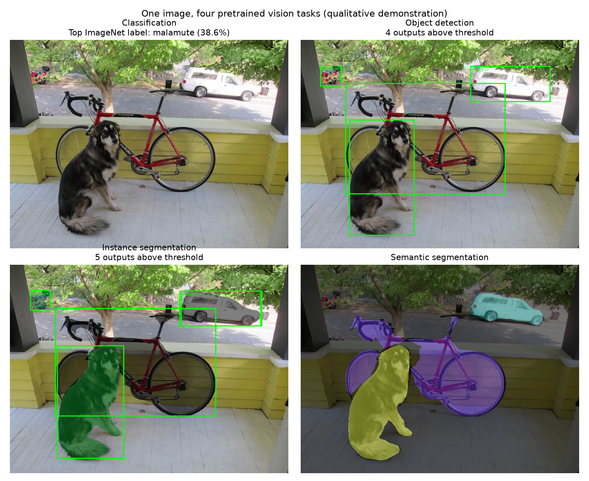

# The CV Zoo and YOLO Geometry

An installable project comparing four pretrained vision tasks and separately explaining grid assignment, vectorized IoU, and anchor shapes. Includes an offline synthetic demo, explicit asset/weight retrieval, auditable JSON outputs, visual reports, and two maintained Jupyter workflows. The original notebook is preserved.

[Automated checks](https://github.com/ssargsyann/aca-projects/actions/workflows/cv-zoo-checks.yml) · [Verified run](docs/results.md) · [Model/use card](MODEL_CARD.md) · [Geometry notes](docs/geometry-notes.md)

## What was verified

All four actual pretrained models ran on the same 768x576 sample with verified official weight files. ResNet-50's top label was `malamute` (softmax 0.3856); Faster R-CNN returned four above-threshold outputs and Mask R-CNN five, including overlapping car/truck hypotheses. DeepLab's class map was restored to original dimensions. These are qualitative predictions on one image, not accuracy/mAP or speed benchmarks.



Sample source: [Darknet dog.jpg](https://github.com/pjreddie/darknet/blob/master/data/dog.jpg). Model/task outputs can disagree; see the [full report](docs/results.md), not just the montage.

The geometry workflow correctly separates shape-only anchor IoU from cell-centered positional IoU. The three hand-entered teaching boxes map to cells `(2,4)`, `(3,3)`, `(5,1)` on a 7x7 grid. Shape-matched anchors are tall, square, and wide, respectively.

## Structure

```text
configs/inference.json         Explicit tasks, thresholds, CPU/device/resize settings
configs/sample_geometry.json   Image dimensions, teaching boxes, anchor shapes
src/cv_zoo/
  geometry.py                 Validated vectorized numerical routines
  geometry_workflow.py         Offline demo and geometry visualization
  models.py                   Pinned weight enums and checksum verification
  postprocess.py              Filtering and original-size semantic alignment
  inference.py                Four sequential pretrained tasks and montage
  sample.py                   Explicit checksum-pinned public sample retrieval
  cli.py                      Command-line interface
tests/                        Numerical and output-contract regression checks
notebooks/                    Synthetic geometry, real inference, original notebook
assets/                       Local image instructions; images ignored
artifacts/                    Ignored weights, masks, images, and run outputs
docs/                         Corrected concepts and verified JSON/figures
```

## Install

Python 3.10 or newer. From the collection root:

```bash
cd projects/cv-zoo-yolo-pytorch
python -m venv .venv
```

Activate `.venv\Scripts\Activate.ps1` in Windows PowerShell or `source .venv/bin/activate` on macOS/Linux.

For geometry only, without PyTorch/model weights:

```bash
python -m pip install -e ".[plots]"
cv-zoo demo --output artifacts/demo
```

For the tested CPU inference route:

```bash
python -m pip install torch torchvision --index-url https://download.pytorch.org/whl/cpu
python -m pip install -e ".[models,plots]"
```

Compatible CUDA installs can be selected through [PyTorch's official instructions](https://pytorch.org/get-started/locally/). Configuration supports cpu/cuda/auto; MPS is not promised for the detection operators. Tested Windows/Python 3.12 CPU versions are listed in `constraints-py312-cpu-tested.txt`, including +cpu wheel versions from the CPU index. It is not a complete cross-platform notebook lock.

## Explicit retrieval and pretrained inference

```bash
cv-zoo sample --output assets/dog.jpg
cv-zoo weights --cache-dir artifacts/weights
cv-zoo infer --image assets/dog.jpg --config configs/inference.json --weights-dir artifacts/weights --output artifacts/inference
cv-zoo montage --run artifacts/inference --output artifacts/inference/montage.png
```

The sample command verifies the recorded SHA-256 before saving. It preserves existing destinations. The four pinned weight files total about 603 MiB; they are fetched only by the explicit `weights` command, or reused from a chosen cache. Inference validates all selected hashes before loading and never silently downloads. Model construction disables implicit backbone downloads; state dictionaries are loaded with restricted deserialization and strict keys. Use trusted official files only.

For an existing Torch checkpoint cache, pass its checkpoint directory as `--weights-dir`. Choose a new/empty run directory each time. You can select a subset of tasks by editing the JSON configuration. The verified CPU settings are score threshold 0.7, mask threshold 0.5, detector min/max size 640/960, and two Torch threads. The models run sequentially to reduce simultaneous memory use.

## Geometry on an annotated image

```bash
cv-zoo geometry --image assets/dog.jpg --annotations configs/sample_geometry.json --output artifacts/geometry
```

Annotation dimensions must exactly match the image. Boxes must be valid finite xyxy coordinates inside it. Centers map to `(column,row)` cells; exact outer boundaries map to the last cell, genuinely outside coordinates are rejected. General pairwise IoU supports empty/zero-area inputs and is tested against Torchvision.

Shape matching aligns box and anchor centers, measuring width/height fit independently of location. A separate JSON field reports cell-centered positional IoU. Neither is a complete YOLO assignment/loss implementation. The notes distinguish YOLOv1's shared-cell class representation from per-anchor class predictions and avoid claiming that all YOLO generations use the same design. See [corrected mathematical scope](docs/geometry-notes.md).

## Outputs and interpretation

Inference writes `results.json`, four preview images, compressed instance masks, and an original-size semantic label map. Metadata includes image/weight hashes, exact enums, library versions, coordinate frame, thresholds, and resize policy. Detection/instance boxes retain original-image pixel coordinates. Semantic logits are resized to the original dimensions before argmax; overlays therefore align with the input image.

The task label spaces differ. Model scores are uncalibrated; duplicate/incorrect detections can remain, especially across classes. ResNet classification does not localize an object, and semantic segmentation does not separate individual instances. No dataset benchmark, custom training, real-time guarantee, or production deployment is claimed. Asset provenance and provider terms are recorded separately from software licensing; no unsupported blanket MIT claim is made.

## Notebooks and tests

```bash
python -m pip install -e ".[notebook]"
jupyter lab
python -m unittest discover -s tests -v
```

Open [quickstart.ipynb](notebooks/quickstart.ipynb) for synthetic geometry or [real-inference.ipynb](notebooks/real-inference.ipynb) for all four actual pretrained models plus sample geometry. Select the environment containing this package. Retrieve the image/weights first. `CV_ZOO_IMAGE` and `CV_ZOO_WEIGHTS_DIR` can point notebooks at existing caches. The original notebook remains unchanged as a historical reference, with its conceptual corrections documented separately.

CI runs network-free regression tests and the synthetic geometry command, not large pretrained downloads. See [the validation record](docs/validation.md), [asset notes](assets/README.md), and [use card](MODEL_CARD.md).
