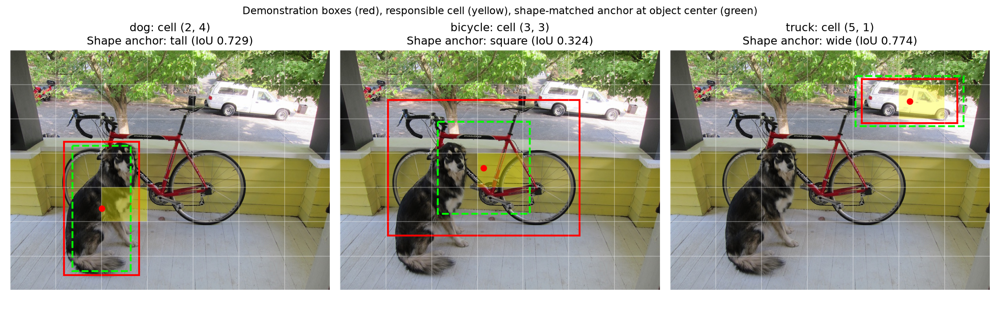

# Verified pretrained inference and geometry

Run date: 2026-10-23. The maintained package ran all four actual pretrained models sequentially on the 768x576 Darknet sample image using CPU and two Torch threads. Four cached official files passed SHA-256 filename-prefix validation; full hashes, enum identities, URLs, settings, and package versions are in [results.json](results.json). No training or dataset-level benchmark was performed.

## Four tasks, one image

| Task | Verified output |
| --- | --- |
| ResNet-50 classification | Top ImageNet label `malamute`, softmax score 0.385626 |
| Faster R-CNN detection | 4 outputs with score > 0.7: bicycle, dog, truck, motorcycle |
| Mask R-CNN instance segmentation | 5 outputs with score > 0.7: bicycle, dog, car, motorcycle, truck |
| DeepLabV3 semantic segmentation | Original-size 576x768 label map; background, bicycle, car, dog present |

Image source: [Darknet dog.jpg](https://github.com/pjreddie/darknet/blob/master/data/dog.jpg). This preview is an illustrative result on that source image, not an evaluation dataset. The local source was independently matched to the public asset by the explicit retrieval helper's SHA-256 check.

The car and truck instance outputs overlap on the same vehicle. They are not evidence that five distinct ground-truth objects have been correctly segmented. Models may disagree, and class-wise suppression does not eliminate every cross-class duplicate. DeepLab's VOC-label vocabulary differs from the detectors' COCO vocabulary; it does not contain the same truck category. Classification scores are not localization or calibrated correctness estimates.

Detection boxes and instance masks use original-image coordinates. DeepLab's weight transform resizes its input; the maintained code restores logits to original dimensions before argmax and overlay. Present-class pixel counts sum to 442,368 (768x576), including background. Individual output masks and the raw semantic array remain local.

Settings: score threshold 0.7, mask threshold 0.5, detector minimum size 640 and maximum size 960. Classification and semantic preprocessing come from the pinned weight enums. This detector resize policy differs from the original notebook's implicit defaults, so predictions need not be identical to its saved figures.

## Educational geometry

The manual teaching boxes produce:

| Annotation | Center (x,y) | Cell (column,row) | Shape anchor | Shape IoU | Same template at cell center: IoU |
| --- | --- | --- | --- | ---: | ---: |
| dog | (220,380) | (2,4) | tall | 0.729167 | 0.467172 |
| bicycle | (345,282.5) | (3,3) | square | 0.323746 | 0.323746 |
| truck | (575,122.5) | (5,1) | wide | 0.774038 | 0.697332 |

The shape and cell-centered values answer different geometric questions. These boxes are approximate annotations, not validated ground truth for computing detection mAP. See [geometry-results.json](geometry-results.json) and [corrected mathematical notes](geometry-notes.md).

## Reproduce

Use the README's explicit sample and weight retrieval commands, then run `infer`, `montage`, and `geometry`. New/empty output folders preserve earlier runs. The exact input SHA-256 is `5a9522051c3cec2bbd2f6323fccba32e8fbf3ddcc2b3e2fd46b04c720bc6f866`.

Environment: Python 3.12.14 on Windows, torch 2.14.1+cpu, torchvision 0.29.1+cpu, NumPy 2.5.4, and Pillow 13.0.0. Tested package versions are constrained separately. Only previews and JSON are published; weight files, source images, and full masks stay local. No mAP, accuracy percentage, real-time throughput, or relative speed result is claimed from this single-image run.
