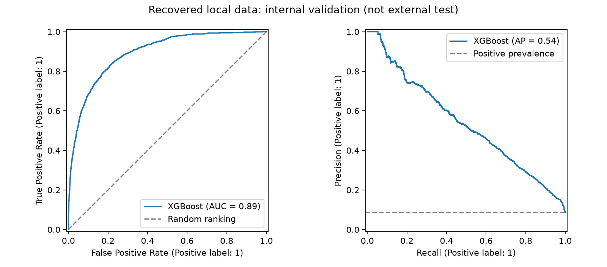
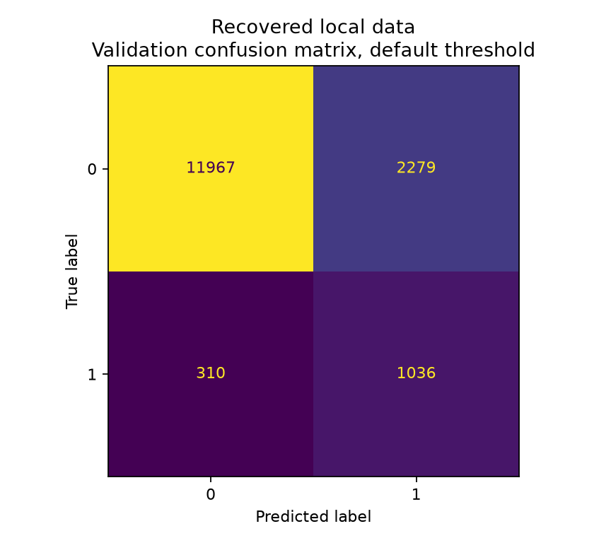

# Recovered-data training and validation

Run date: 2026-10-23. This report records an actual run of the maintained pipeline on the local `icu_train.csv` recovered from the user's Jupyter working files. It is separate from the synthetic demo.

## Data and protocol

- Input: 77,956 rows and 186 columns, including `hospital_death`.
- Target counts: 71,228 negatives and 6,728 positives (about 8.63% positive).
- Split: stratified random 80/20, seed 42; 62,364 training rows and 15,592 validation rows.
- Validation labels: 14,246 negatives and 1,346 positives.
- The supplied `patient_id` column contained no duplicate values within this file. This does not establish patient independence across unknown upstream sources or external datasets.
- Configuration: `configs/default.json`, unmodified. XGBoost: 200 estimators, learning rate 0.05, maximum depth 5, training-derived class weighting.
- Missingness filtering, imputation, encoding, and weighting were learned from the training partition only. Identifiers and configured APACHE mortality-probability columns were excluded. There were 122 retained predictors before encoding.

## Validation results

| Measure | Value |
| --- | ---: |
| ROC-AUC | 0.892606 |
| Average precision | 0.539299 |
| Accuracy | 0.833953 |
| Positive-class precision | 0.312519 |
| Positive-class recall | 0.769688 |
| Positive-class F1 | 0.444540 |

These are metrics from one internal validation split, not an independent external test. With the default threshold, the model recovers about 77% of positive validation labels but only about 31% of positive predictions match a positive label. Class weighting favors positive-class detection. An always-negative classifier would achieve about 91.37% accuracy and zero positive-class recall on this validation partition; accuracy alone is therefore not a useful success criterion. Scores have not been calibrated and the threshold has not been clinically selected.

## Aggregate validation figures





Recreate these with `icu-mortality report --run artifacts/real-data-run --data data/icu_train.csv --output artifacts/real-data-report`. The input checksum must match the training run. Figures contain aggregate validation diagnostics only.

## Inference check

The saved pipeline reloaded successfully and wrote predictions for all 13,757 rows in the separate local `icu_hidden_test.csv` (185 columns, no target). No missing required features were reported. A local `icu_labels.csv` also exists, but its row correspondence to the test file has not been verified; it was not used to calculate hidden-test metrics. Equal row counts alone do not establish correct alignment.

## Reproduce with the same authorized input

Place the recovered files in the ignored `data/` directory, install the project, then run from this project directory:

```bash
icu-mortality train --data data/icu_train.csv --config configs/default.json --output artifacts/real-data-run
icu-mortality predict --model artifacts/real-data-run/pipeline.joblib --data data/icu_hidden_test.csv --output artifacts/real-data-run/hidden-test-predictions.csv
```

The raw input, model, and row-level predictions remain local. Only this aggregate report is committed. The upstream dataset URL, license, exact release, feature definitions, and redistribution rights are not established, so no public download instruction is claimed.

Training CSV SHA-256: `eb294565e3647ef6894ba5e7f2e9745ac15f261b98fbb34891ec68f7b8beed33`.

Environment: Python 3.12.14 on Windows; pandas 2.3.3, NumPy 2.5.4, scikit-learn 1.9.1, XGBoost 3.4.1, joblib 1.6.0. The local `run.json` records the full configuration and retained feature names. Exact results can vary with environment changes.

## Remaining limits

Feature timing must be reviewed before claiming predictions at admission or within a particular time window. Cross-hospital generalization, temporal validation, calibration, threshold selection, and clinical utility have not been demonstrated. The random validation split may share hospital-specific patterns with training. This is an educational model, not a validated care system.
