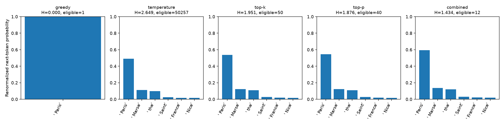

# Raw-Logit Decoding Strategies

Greedy decoding, temperature, Top-K and Top-P sampling implemented with explicit PyTorch tensor operations. The generation loop calls a locally loaded GPT-2 model's forward pass directly, with optional KV caching, per-step diagnostics and isolated sampling RNGs. Includes an offline synthetic demo, a checksum-pinned model fetcher, reproducible comparisons, maintained notebooks and regression tests.

[Measured comparison](docs/results.md) · [Sampling contracts](docs/sampling.md) · [Model/use card](MODEL_CARD.md) · [Model provenance](docs/provenance.md) · [Automated checks](https://github.com/ssargsyann/aca-projects/actions/workflows/llm-decoding-checks.yml)

## Verified behavior

A real GPT-2 CPU comparison ran **20 continuations / 480 generated tokens**: two prompts, five strategies, seeds 7 and 42, and 24 new tokens each. Eleven tests passed, including reference-filter and tiny randomly initialized GPT-2 cache checks. An additional real pretrained-model check reproduced seeded output and matched cached/uncached/reference greedy IDs on a checked eight-token example.



For the France prompt's first step, the eligible pools were 1 (greedy), 50,257 (temperature only), 50 (Top-K), 40 (Top-P) and 12 (combined). These describe processed sampling distributions, not factual confidence. Full continuations exhibit repetition and unsupported claims; this is an algorithm demonstration, not a quality benchmark.

## Structure

```text
configs/                         Single-generation and predeclared comparison settings
src/llm_decoding/
  sampling.py                    Validated temperature, Top-K, Top-P, probabilities
  engine.py                      Local GPT-2 loading and explicit cached forward loop
  assets.py                      Fixed revision and upstream asset identities
  workflow.py                    Single runs and reproducible comparisons
  reports.py                     Synthetic/real probability and trace figures
  cli.py                         Command-line entry points
tests/                           Mathematical, decoding and integration contracts
notebooks/                       Two maintained workflows and original notebook
docs/                            Full traces, figures, source hashes and limitations
assets/ artifacts/               Local weights/outputs; ignored except guides
```

## Install and offline demo

Python 3.10+; tested with Python 3.12 on Windows CPU. From the collection root:

```bash
cd projects/llm-decoding-strategies
python -m venv .venv
```

Activate `.venv\Scripts\Activate.ps1` in Windows PowerShell or `source .venv/bin/activate` on macOS/Linux.

```bash
python -m pip install torch --index-url https://download.pytorch.org/whl/cpu
python -m pip install -e .
llm-decoding demo --output artifacts/toy-demo
```

The synthetic demo uses the original ten-logit teaching vector and downloads nothing. For GPT-2 and notebooks:

```bash
python -m pip install -e ".[gpt2,notebook]"
llm-decoding fetch-model --output assets/gpt2
llm-decoding verify-model --model-dir assets/gpt2
```

The explicit fetch command retrieves seven files from `openai-community/gpt2` at fixed revision `607a30d783dfa663caf39e06633721c8d4cfcd7e`. The safetensors weight file is 548,105,171 bytes (about 523 MiB); tokenizer/config/card files add a few MiB. It verifies the upstream weight SHA-256 and pinned Git blob identities for other files, then records full local SHA-256 values. Full model binaries remain ignored. Choose a fresh output directory; interrupted downloads remain available for inspection.

Loading accepts only an existing verified local pinned directory, with `local_files_only=True`, safetensors and no remote code. Generation/comparison never fetch missing models. CPU float32, eager attention and two Torch threads are the tested route. `--device cuda` is supported when available but unverified. Observed direct versions are recorded in `constraints-py312-cpu-tested.txt`.

## Generate and compare

```bash
llm-decoding generate --model-dir assets/gpt2 --prompt "Deep learning is fundamentally about" --config configs/sampling.json --output artifacts/example
llm-decoding compare --model-dir assets/gpt2 --config configs/comparison.json --output artifacts/comparison
```

`configs/sampling.json` specifies strategy, temperature, Top-K, Top-P, new-token budget, seed and KV-cache use. Greedy uses raw argmax; sampling applies **temperature → Top-K → Top-P → normalization → draw**. Top-P is computed after temperature and after renormalizing any Top-K subset, so combined sampling differs from applying Top-P alone. [Exact numerical/tie contracts](docs/sampling.md).

Each generation stops at EOS or its requested token budget. Empty prompts and requests exceeding GPT-2's 1,024-position context are rejected without truncation. A zero-token single run is allowed; comparisons require a positive budget. Tokens are subword/byte-level BPE units, not necessarily words. No beam search, repetition penalty, instruction tuning or batch generation is implemented.

The engine uses a per-run `torch.Generator`, leaving the global sampling RNG unchanged. Same-seed reproducibility was checked on the measured CPU/version combination; identical results across hardware/backends/releases are not promised. Cache mode feeds the full prompt once, then one new token per step, retaining the full attention mask. Uncached mode recomputes the whole prefix. The production generation path does not call Transformers' high-level `.generate()`; a separate validation used it only as a reference.

Outputs include full generated IDs/text, per-token eligibility, processed entropy, sampling probability and original-model log probability. Comparisons write all continuations/traces as JSONL, the exact config, source/runtime manifest, first-step distribution JSON/PNG, descriptive continuation plots and summary JSON. `distinct_1`/`distinct_2` are token type ratios, not quality measures; they depend on length. New/empty output directories preserve earlier runs.

## Notebooks and tests

```bash
jupyter lab
python -m unittest discover -s tests -v
```

- [sampling-primitives.ipynb](notebooks/sampling-primitives.ipynb) runs entirely offline without GPT-2 assets.
- [local-gpt2-comparison.ipynb](notebooks/local-gpt2-comparison.ipynb) reproduces the real 20-run comparison and checks seeded/cache behavior; fetch assets first. `LLM_DECODING_MODEL` can select an existing pinned local directory.
- [original_experiment.ipynb](notebooks/original_experiment.ipynb) preserves the imported notebook unchanged. It used a different filter order, implicit model downloads, near-zero/negative-temperature shortcut and no EOS stop; maintained behavior is documented explicitly.

The eleven tests cover mathematical edge cases, nonmutation/ties, scaling order, EOS/context/cache shapes, seed isolation, output preservation and network-free framework integration. Without the `gpt2` extra, the two framework tests skip; CI installs it and runs all eleven without downloading pretrained weights. [Validation record](docs/validation.md).

GPT-2 is a pretrained English continuation model, not a factual assistant. Samples are unverified model outputs. This project demonstrates decoding and makes no claim that one policy guarantees factuality, coherence or safety. See the upstream model card and project [use card](MODEL_CARD.md).
