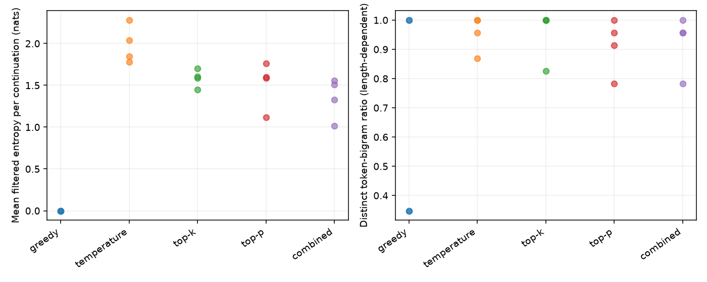

# Verified GPT-2 comparison

Run on 2026-10-23 with Windows/Python 3.12, CPU Torch 2.14.1+cpu, Transformers 4.57.6, eager attention, float32 and two Torch threads. Model revision `607a30d783dfa663caf39e06633721c8d4cfcd7e`; file/runtime identities are in [the manifest](model-manifest.json).

Predeclared experiment: 2 prompts × 5 policies × seeds 7/42 = **20 continuations**, each with 24 new tokens, **480 tokens total**. All stopped at their budgets. Sampling policies use T=0.7; K=50 and P=0.9 apply where enabled. Greedy uses raw argmax. [Exact settings](experiment.json), [all outputs and step traces](continuations.jsonl), [summary](summary.json).

## Same first-step logits

Prompt: `What is the capital of France? It is the city of`. Token ID 6342 (` Paris`) has the highest raw next-token score. Its probability changes after policy normalization; these are not calibrated truth probabilities.

| Policy | Eligible tokens | Processed entropy (nats) | Processed probability of ` Paris` |
|---|---:|---:|---:|
| greedy | 1 | 0.000000 | 1.000000 |
| temperature | 50,257 | 2.648745 | 0.491047 |
| top-k | 50 | 1.951475 | 0.537825 |
| top-p | 40 | 1.875913 | 0.544986 |
| combined | 12 | 1.434476 | 0.594967 |

Top-P is calculated after temperature and, in the combined policy, after Top-K renormalization. This gives different eligible pools even though P is identical. [Full first-step distributions](first-token.json).

## Descriptive continuation observations

| Policy | Records | Mean processed entropy per continuation (nats) |
|---|---:|---:|
| greedy | 4 | 0.000000 |
| temperature | 4 | 1.984100 |
| top-k | 4 | 1.585758 |
| top-p | 4 | 1.517327 |
| combined | 4 | 1.352115 |

Each plotted point is one continuation. Greedy outputs are duplicated across seeds, since seed does not affect argmax. Later-step contexts differ across sampled outputs; these averages do not isolate a universal policy effect. Distinct-bigram ratios are length-dependent and not quality scores.

The France greedy output repeats `It is the capital of France.` several times. Some sampled outputs make unsupported numeric claims; the combined deep-learning continuation also repeats `finding and finding`. These are disclosed model behaviors, not verified statements. Top-P and combined sometimes produce the same continuation, and temperature-only and Top-K can also coincide. No policy is claimed to guarantee factuality, coherence or removal of repetition.

## Verification and boundaries

The real-model seeded 24-token sample repeated exactly and matched its stored record. A checked eight-token greedy example matched cached, uncached and Transformers reference output IDs. [Recorded checks](reference-checks.json) describe their limited scope. Eleven regression/integration tests passed; framework filters agree on tested nonboundary logits, and exact-CDF/tie behavior follows the documented contract. Synthetic results are [stored separately](synthetic-distributions.json).

This is a small qualitative experiment, without a labeled benchmark, human quality ratings, significance test, held-out perplexity, speed benchmark or CUDA validation. The original notebook used another ordering, so its historical samples are not direct comparable measurements. See the sampling contracts and model/use card before drawing broader conclusions.
