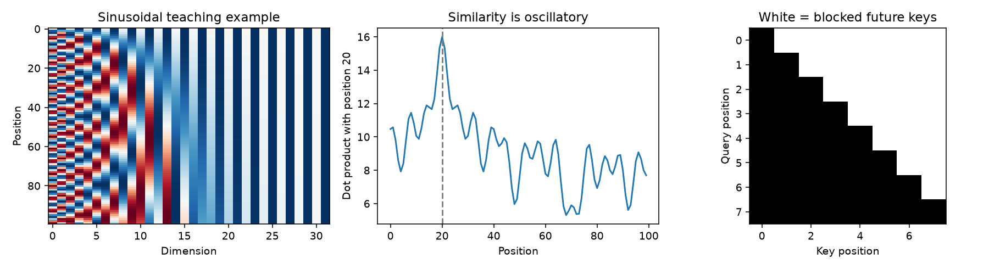

# Concepts and historical corrections

The imported notebook is retained unchanged for traceability. The maintained code/docs make these distinctions explicit.

1. **Attention implementation.** Encoder/decoder assembly is explicit here, while PyTorch MultiheadAttention provides projections and attention computations. Learned per-head Q/K/V projections and the output projection are essential; reshaping alone is not the complete operation. Boolean masks in this module block positions where True, with matching causal/padding dtypes. See [PyTorch MultiheadAttention](https://docs.pytorch.org/docs/stable/generated/torch.nn.MultiheadAttention.html).
2. **Positions.** The trained model uses learned absolute positions. The separate sinusoidal example supports odd widths and illustrates multiple frequencies. Its position-vector dot product is a sum of oscillatory cosine terms, not a universally smooth or monotonic distance-decay law. This figure does not prove a model has learned a particular relative-position behavior. See [Attention Is All You Need](https://arxiv.org/abs/1706.03762).
3. **Tokenizer naming.** The historical `bert-base-uncased` demo uses WordPiece, not BPE. The actual date task uses the project's character vocabulary; it does not use BERT tokens or weights. See the [official BERT tokenizer documentation](https://huggingface.co/docs/transformers/model_doc/bert#transformers.BertTokenizer). Maintained execution has no tokenizer download.
4. **Timing scope.** An unsynchronized CUDA wall-clock comparison of an RNN loop with only the QK matrix multiplication does not compare complete models. It omits warmup/repeated timings and major attention components. No maintained speedup or benchmark claim is based on it; the mechanics notebook is qualitative and network-free.
5. **Evaluation.** Teacher forcing supplies the correct target prefix; greedy decoding must use its own previous outputs. Padding-excluded token accuracy and full-date exact match are different measurements. The measured first validation epoch shows 82.43% teacher-forced token accuracy versus 6% greedy exact dates. There is a disjoint validation/test split and no substitution of rule outputs for neural predictions.
6. **Attention labels.** A decoder step predicts the next token; the captured row labels that predicted token, including EOS when emitted. The historical heatmap could include an EOS weight row while using only visible output-character labels, and could show padded source columns without matching labels. Maintained JSON stores row and column labels and validates their dimensions before rendering. Cross-attention illustrates model behavior but is not proof of a causal explanation.
