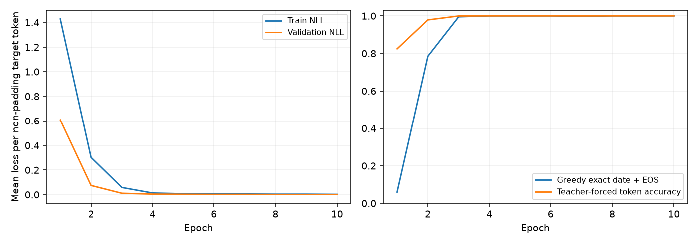
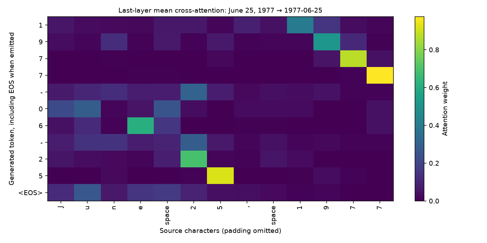

# Verified CPU experiment

Run on 2026-10-23, Windows/Python 3.12 with CPU Torch 2.14.1+cpu and two Torch threads. Configuration: seed 42, 4,000 training / 400 validation / 400 test unique dates, ten epochs, batch 64, Adam learning rate 0.001, gradient norm clip 1. Architecture: 64 dimensions, four heads, two encoder/decoder layers, feed-forward 128, learned positions, 179,626 parameters. [Complete measured record](results.json).

Checkpoint selection used validation greedy exact match and then lower validation NLL. Epoch 10 was selected. The saved state was reloaded before final scoring.

| Measurement | Validation | Test |
|---|---:|---:|
| Greedy exact date with EOS | 400/400 (100%) | 400/400 (100%) |
| Greedy valid ISO text | 400/400 | 400/400 |
| EOS termination | 400/400 | 400/400 |
| Teacher-forced token accuracy | 100% | 100% |
| Teacher-forced NLL per non-pad token | 0.00094245 | 0.00092693 |
| Deterministic rule parser exact match | 400/400 (100%) | 400/400 (100%) |

At epoch 1, validation token accuracy with correct prefixes was 82.43%, but full greedy date exact match was 6%. By epoch 4, validation greedy exact match reached 100%; later epochs tied on exact match, so the NLL tie-break selected epoch 10. Test was not used in this selection. Teacher metrics count 4,400 non-padding tokens per held-out split (ten ISO characters plus EOS per date).

[Every test prediction](test-predictions.jsonl) records source, expected ISO string, generated text/IDs, EOS termination, ISO validity and exact match. [Dataset hashes](dataset-manifest.json) identify exact split membership. The reloaded evaluation command was checked against these metrics. A separate example command generated `2026-08-03` for `August 3, 2026`; no rule output replaced neural decoding.

[Attention JSON](attention.json) contains generated-token row labels, source-character column labels and last-decoder-layer mean-over-heads weights. EOS is labeled explicitly, and padded source columns are excluded. This is a diagnostic, not a causal explanation.

This is one small synthetic, in-distribution date-formatting experiment. All splits share the same English grammar and 1950–2050 range. It does not establish correctness over the complete calendar, multilingual/ambiguous dates, out-of-range years or general translation. The rule parser solves the specified task just as well with no training; the Transformer is an architecture/evaluation demonstration. Historical notebook loss logs used a different unsplit generator and are not fresh test evidence.
