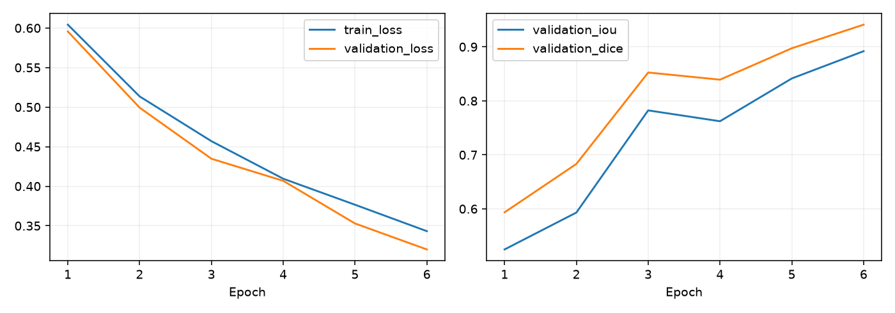
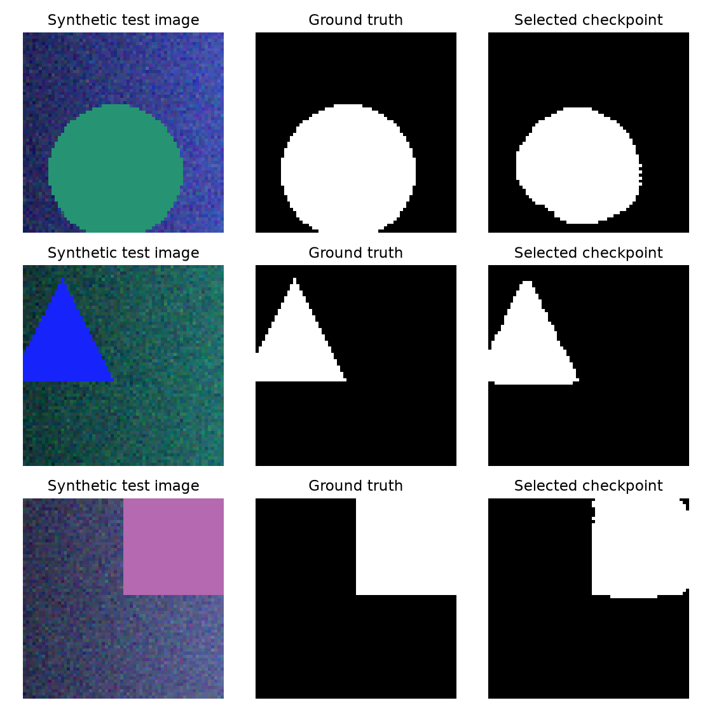
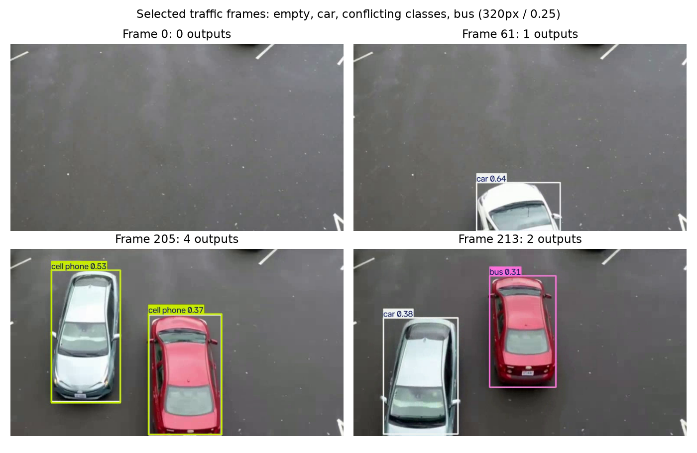

# Verified run report

Run on 2026-10-23 with Python 3.12, Windows CPU and two Torch threads. Exact settings, dependency versions, file hashes, epoch history and final metrics are in the linked JSON records.

## Synthetic U-Net

192 fixed training / 48 validation / 48 test images, seed 42, 64x64, width 8, six epochs, batch 8, Adam learning rate 0.001, threshold 0.5. The model has 486,553 parameters. Validation selected epoch 6.

| Split | Mean foreground IoU | Mean foreground Dice | Combined loss |
|---|---:|---:|---:|
| Validation | 0.891920 | 0.941055 | 0.320050 |
| Test after selection | 0.902169 | 0.947789 | 0.321304 |

These scores describe only the fixed synthetic generator. The generator differs from the historical notebook, and this width-8 experiment does not verify the width-64/15-epoch preset. [Full U-Net record](unet-results.json).

## YOLOv8n training and reloaded image inference

One epoch, 320px, batch 2, seed 42, CPU, 4 train and 4 validation images. Final best-checkpoint validation: precision 0.641954, recall 0.550000, mAP50 0.579237, mAP50-95 0.446033. These are final post-strip validation values; the epoch CSV records an earlier validation pass and its mAP values differ. They must not be mixed into one claimed result.

The reloaded fine-tuned checkpoint processed COCO8 validation image `000000000042.jpg` and returned one `cat` detection (confidence 0.4448) at threshold 0.25. Its supplied annotation has COCO class 16 (`dog`), so the returned category disagrees with the label. This image is part of validation, not an independent test; successful checkpoint loading is not evidence of a correct prediction. Original pixel boxes and confidence are retained in [the detection record](yolo-image-detections.jsonl), with [run provenance](yolo-image-results.json).

COCO8 is explicitly a tiny smoke dataset, with possible pretrained COCO train2017 overlap. These numbers do not establish improvement over the pretrained base, full-COCO mAP, or performance on unseen traffic. [Final results](yolo-results.json), [raw epoch CSV](yolo-training.csv), [dataset manifest](coco8-manifest.json).

## Traffic video inference

The official pretrained base (not the tiny fine-tune) first processed a 48-frame smoke with zero detections, then the full 377-frame video at 320px/confidence 0.25. The full run returned 165 frame-wise boxes in 113 frames. Its annotated MP4 was decoded again and contained all 377 frames at source FPS 12.5. The smaller 48-frame output was also decoded and checked. Neither run was scored against video ground truth.

| Returned class | Boxes across frames |
|---|---:|
| car | 81 |
| cell phone | 62 |
| bus | 14 |
| boat | 3 |
| airplane | 2 |
| truck | 2 |
| bottle | 1 |

A box can recur on many frames, and cross-class duplicates remain: frame 205 contains overlapping `car` and `cell phone` boxes on the same regions. These counts are neither distinct-object counts nor correct-detection counts. No tracking, labeled accuracy or reliable traffic-monitoring claim is made.

Frames 0, 61, 205 and 213 were deliberately selected to illustrate empty outputs, a car output, category conflicts and a bus output; they are not a random performance sample. Video source: Intel IoT DevKit [sample-videos/car-detection.mp4](https://github.com/intel-iot-devkit/sample-videos), [CC BY 4.0](https://github.com/intel-iot-devkit/sample-videos/blob/master/LICENSE). The figure extracts frames and overlays model predictions. Full video and weights stay local. [Full video run](full-video-results.json), [per-frame boxes](full-video-detections.jsonl), [48-frame smoke](video-results.json), [source hashes](download-manifest.json).
